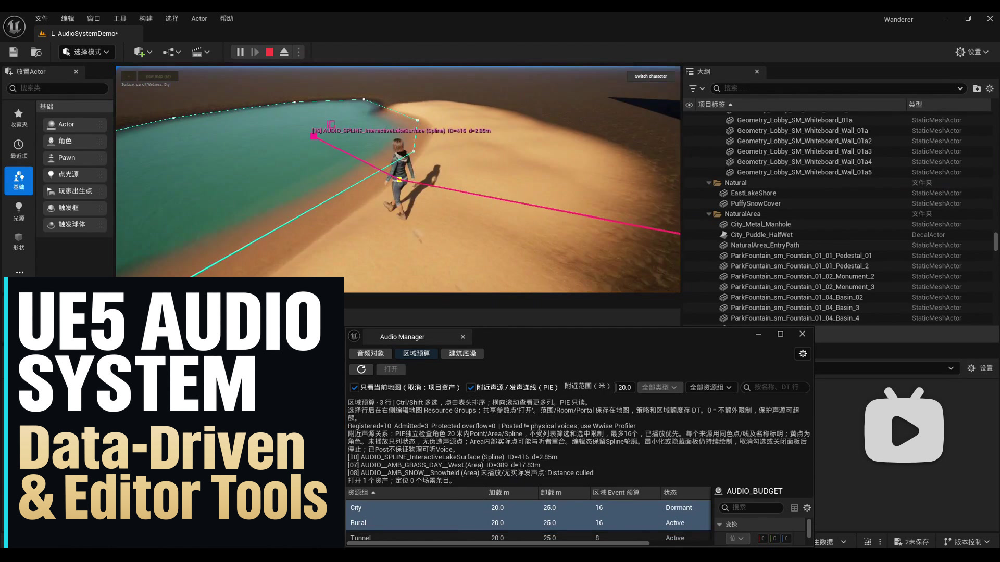

# Wanderer

Wanderer 是一个 Unreal Engine 5 游戏原型，包含角色选择、地图探索、环境交互和 Wwise 空间音频。由于游戏项目资产体积较大，此处仅公开 `Source/` 下的项目代码。

## 代码架构与目录结构 (Code Architecture)

### Runtime Module

| 目录 | 职责 |
|---|---|
| `Types/`、`Interfaces/` | 定义共享类型与跨系统接口。 |
| `Core/`、`Data/` | 提供事件总线、通用工具和数据配置。 |
| `Framework/` | 协调游戏流程、选角、场景加载与地图交互。 |
| `Systems/` | 管理世界昼夜、音频调度与资源生命周期。 |
| `Characters/`、`Actors/`、`Components/` | 组装角色和场景实体，提供脚步、地表交互及声音播放等可复用能力。 |
| `UI/` | 展示状态并处理界面交互。 |

模块间共用的接口和类型通过 `Public/` 暴露，内部实现放在 `Private/`。界面通过模型或接口读取状态，运行时模块无需依赖编辑器工具。

### Editor Module

| 工具 | 职责 |
|---|---|
| [Audio Manager](./Wanderer/Source/WandererEditor/Private/Features/AudioManager) | 定位和配置 Point、Area、Spline、Room 与 Portal，管理建筑共享底噪和区域预算，在 PIE 中查看发声位置与播放状态。 |
| [Wwise Browser 扩展](./Wanderer/Source/WandererEditor/Private/Features/WwiseBrowserExt) | 将 Wwise Event、Switch、RTPC 等资产按Wwise中的目录同步到 UE Content。 |

## 核心功能模块与源码索引 (Core Features & Code Index)

| 类别 | 功能 | 实现位置 |
|---|---|---|
| Gameplay | 角色预览与切换 | [选角模型](./Wanderer/Source/Wanderer/Private/Framework/CharacterSelectionModel.cpp) · [选角界面](./Wanderer/Source/Wanderer/Private/UI/Characters) |
| Gameplay | 地图扫描与传送 | [地图逻辑](./Wanderer/Source/Wanderer/Private/Framework/Mapping) · [传送实现](./Wanderer/Source/Wanderer/Private/Core/CharacterTeleportLibrary.cpp) |
| Gameplay | 昼夜切换 | [世界环境状态](./Wanderer/Source/Wanderer/Private/Systems/WandererEnvironmentSubsystem.cpp) |
| Gameplay | 地表识别与浅水交互 | [地表采样](./Wanderer/Source/Wanderer/Private/Framework/Surface) · [场景交互组件](./Wanderer/Source/Wanderer/Private/Components/SurfaceInteraction) |
| Runtime Audio | 环境声的区域预载、播放预算与释放 | [音频调度](./Wanderer/Source/Wanderer/Private/Systems/Audio) · [资源组配置](./Wanderer/Source/Wanderer/Private/Data/Audio/WorldAudioBudgetData.cpp) |
| Runtime Audio | Point、Area、Spline、Room、建筑底噪与昼夜环境声 | [声源几何](./Wanderer/Source/Wanderer/Private/Actors/Audio) · [世界声源播放](./Wanderer/Source/Wanderer/Private/Components/WorldAudio) |
| Runtime Audio | 角色脚步与动作音效 | [脚步接触](./Wanderer/Source/Wanderer/Private/Components/Footsteps) · [角色音频](./Wanderer/Source/Wanderer/Private/Components/CharacterAudio) |
| Runtime Audio | Radio 控制与同步播放 | [控制模型](./Wanderer/Source/Wanderer/Private/Framework/RadioControlModel.cpp) · [播放管理](./Wanderer/Source/Wanderer/Private/Systems/Audio/RadioPlaybackManager.cpp) |
| Runtime Audio | UI 音效、菜单压低与水下混音 | [UI 音效](./Wanderer/Source/Wanderer/Private/Systems/Audio/WandererUIAudioSubsystemPlayback.cpp) · [监听者混音](./Wanderer/Source/Wanderer/Private/Systems/Audio/ListenerAudioManager.cpp) |

用于自动生成 Area／Spline 几何的 UE 插件在 GitHub 独立发布。[InteriorFit](https://github.com/KwDing/InteriorFit)
